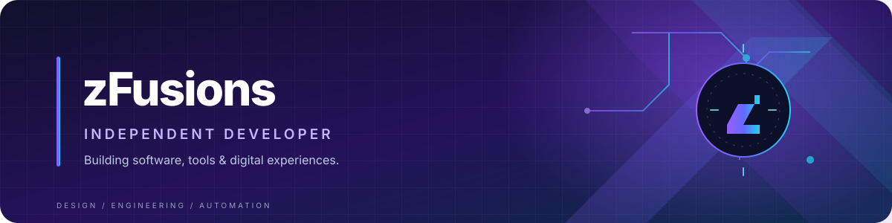

<picture>
  <source media="(prefers-color-scheme: light)" srcset="https://raw.githubusercontent.com/zFusions/zFusions/main/assets/profile-light.svg">
  
</picture>

 

**I turn ideas into useful software and polished digital experiences.**

[Projects](#-selected-work) · [Tech stack](#-toolkit) · [Contact](#-connect)

---

### ✦ About

Independent developer interested in building **desktop software, automation, Discord tooling and premium web experiences**. I enjoy taking ideas from concept to a clean, usable product.

### ◈ Selected work

  
  

### ⌘ Toolkit

### ⟡ GitHub activity

### ↗ Connect

 

Designed with precision. Built with curiosity.

